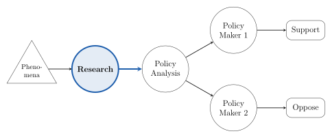

```{=html}

```

I study how evidence reaches policy, and how transparency can build a common understanding of that evidence. My work sits at two points of the chain in the diagram above. At the research node, I measure whether the results economists plan to test ever become public, and I develop standardized formats for reporting them. At the policy analysis node, I developed Open Policy Analysis, a framework that makes the data, code, and assumptions behind a policy estimate open to inspection. Going forward, my main line of research is the standardization of research results, including tools built on large language models that make it affordable at scale. My second line builds new open policy analyses with the same tools.

::: {.text-center}
[<i class="bi bi-file-earmark-pdf"></i> Research Statement](files/research-statement.pdf)
:::

## Job Market Paper

**"Beyond Publication Bias: Characterizing and Understanding Missing Results in Economics"**\
Hoces de la Guardia, F., Miguel, E., Pathan, G., Shaji, A., Silva da Rocha, V., Sørensen, E., Tungodden, B.\
([latest version](files/jmp.pdf), slides [here](https://fhoces.github.io/BITSS-AM-2026-slides/#1), [talk at the BITSS Annual Meeting 2026](https://www.youtube.com/watch?v=JqyH0s2f8TI&t=15s)[, [study results page](file:///Users/fernando/Desktop/sandbox/RGPB_repos/rgpb-phase2-clean-analyse/docs/policy-recs/lessons/index.html)]{.content-visible when-profile="local"}[, study results page coming soon]{.content-hidden when-profile="local"})

We standardized 5,057 pre-registered hypotheses from 317 studies in the AEA RCT Registry and tracked each one to its result.

- 58% have no public result 8 to 9 years after pre-registration. Of the results that are public, 64.5% are null, and nulls do not appear to be disproportionately missing.
- In an RCT with over 300 research teams, direct engagement with authors raised reporting by 6.2 percentage points. A light-touch awareness message did not, and paid research assistance added nothing beyond engagement.
- Engagement cut the share of hypotheses with neither a result nor an explanation by 16.4 points. Even so, 44.8% of hypotheses in treated studies remain unaccounted for.

::: {.callout-note collapse="true" appearance="simple"}
## Abstract

What researchers choose *not* to publish can be as important as what they do. Across 5,057 pre-registered hypotheses from 317 studies on the AEA RCT Registry between 2015-2017, we show only 42% have publicly available results 8-9 years later. Among results, 64.5% are null, with little evidence nulls are disproportionately missing. In an RCT, engagement with authors increases availability by 6.2 percentage points and reduces the share unaccounted for by 16.4 points. The findings document extensive under-reporting in economics and suggest reporting pre-registered results may need to become part of the research process rather than something recovered years later.
:::

## Published and Working Papers

### Working Papers

::: pub-list
- "Assessing Reproducibility in Economics Using Standardized Crowd-sourced Analysis"; Abel Brodeur ⓡ Seung Yong Sung ⓡ Edward Miguel ⓡ Lars Vilhuber ⓡ Fernando Hoces de la Guardia. [NBER w33753](https://www.nber.org/papers/w33753)
:::

### Published Papers

::: pub-list
- "Reproducibility and robustness of economics and political science research"; Brodeur, A., Mikola, D., Cook, N, Fiala, L. ..., Hoces de la Guardia, F .....; *Nature*, 2026. [DOI](https://doi.org/10.1038/s41586-026-10251-x) [free version](https://researchonline.lse.ac.uk/id/eprint/137919/)
- "Promoting reproducibility and replicability in political science"; Brodeur, A., Esterling, K., Ankel-Peters, J., Bueno, N., Desposato, S., Dreber, A., Genovese, F., Green, D., Hepplewhite, M., Hoces de la Guardia, F., et. al.; *Research & Politics*, 2024. [DOI](https://doi.org/10.1177/20531680241233439)
- "Reproduction and replication at scale"; Brodeur, A., Dreber A., Hoces de la Guardia, F., Miguel, E.; *Nature Human Behaviour*, Correspondence, 2024. [DOI](https://doi.org/10.1038/s41562-023-01807-2)
- "Replication games: how to make reproducibility research more systematic"; Brodeur, A., Dreber A., Hoces de la Guardia, F., Miguel, E.; *Nature*, Comment, 2023. [DOI](https://doi.org/10.1038/d41586-023-02997-5) [free version](https://escholarship.org/uc/item/1qj8937s)
- "A Framework for Open Policy Analysis", F. Hoces De La Guardia, S. Grant, E. Miguel; *Science and Public Policy* 48.2;154-163; 2021. [DOI](https://doi.org/10.1093/scipol/scaa067) [free full text](http://tinyurl.com/1qypbihb)
- "A consensus-based transparency checklist"; Aczel, B., Szaszi, B., Sarafoglou, A., Kekecs, Z., Kucharský, Š., Benjamin, D., ... F. Hoces de la Guardia..., & Ioannidis, J. P; *Nature Human Behaviour*; 2019.1-3. [DOI](https://doi.org/10.1038/s41562-019-0772-6)
:::

### During & Pre-PhD

::: pub-list
- "Loss Function-based Evaluation of Physician Report Cards"; F. Hoces de la Guardia, J. Hwang, JL Adams, SM. Paddock. *Health Services and Outcomes Research Methodology*; 2018. [DOI](https://doi.org/10.1007/s10742-018-0179-2)
- "Optimizing Variance-Bias Trade-off in the TWANG Package for Estimation of Propensity Scores"; L. Parast, D. McCaffrey, L. Burgette, F. Hoces de la Guardia, D. Golinelli, JNV Miles, BA Griffin; *Health Services and Outcomes Research Methodology*; 2017. [DOI](https://doi.org/10.1007/s10742-016-0168-2) [free version](https://pmc.ncbi.nlm.nih.gov/articles/PMC5667923/)
- "Better-than-average and worse-than-average hospitals may not significantly differ from average hospitals: an analysis of Medicare Hospital Compare ratings"; SM Paddock, JL Adams, F. Hoces de la Guardia; *BMJ Quality & Safety*; 2015. [DOI](https://doi.org/10.1136/bmjqs-2014-003405)
- "Evaluating the Chile Solidario Program: Results Using the Chile Solidario Panel and the Administrative Databases", F. Hoces De La Guardia, A. Hojman, O. Larranaga; *Revista Estudios de Economia*, 2011. [DOI](https://doi.org/10.4067/s0718-52862011000100006)
:::
